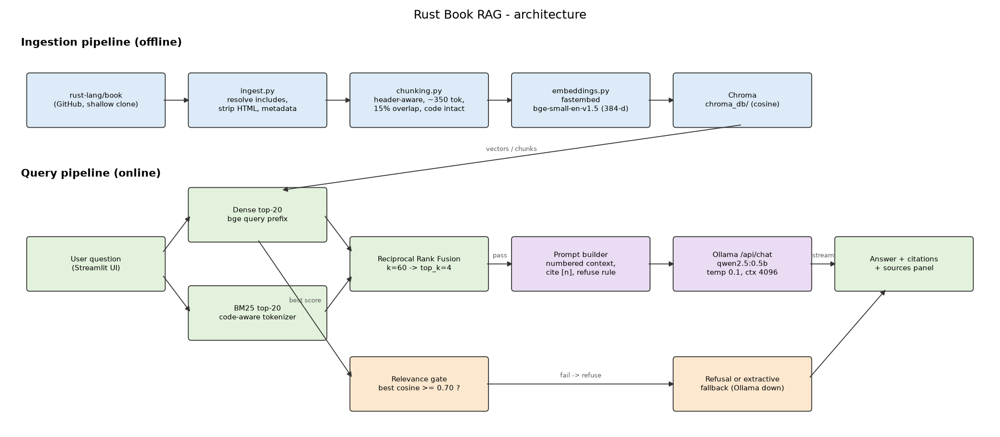

# Rust Book RAG: a source-grounded Q&A assistant for *The Rust Programming Language*

A Retrieval-Augmented Generation (RAG) application that answers questions about Rust using only passages
retrieved from *The Rust Programming Language* book. Every answer cites its sources, links to the online
book, and the assistant refuses when the book does not cover the question.

**Target users:** students and developers learning Rust who want quick answers they can check against the book.



## Features
- **Corpus:** the official Rust Book source (`rust-lang/book`, MIT / Apache-2.0), with mdBook `{{#include}}`
  directives resolved so code listings are part of the text.
- **Header-aware chunking:** chunks follow the book's headings, carry their heading path
  (e.g. `Understanding Ownership > References and Borrowing`), target ~350 tokens with ~15% overlap,
  and never split a code block.
- **Three retrieval modes:** dense (bge-small + Chroma), BM25 with a Rust-aware tokenizer, and hybrid
  (Reciprocal Rank Fusion).
- **Relevance gate:** low-similarity questions are refused before the LLM is called.
- **Grounded generation:** a local LLM through Ollama (`qwen2.5:0.5b` by default) answers only from numbered
  context and cites `[1]`, `[2]`, ...
- **Graceful degradation:** if Ollama is down, a clearly labelled extractive answer (the best passage) is shown.
- **Streamlit UI:** streamed answers, sources panel with scores and links, mode / top_k / model controls,
  latency display, Ollama status, and example questions.
- **Evaluation:** a 40-question hand-checked test set, retrieval metrics for all modes, end-to-end answer metrics,
  threshold tuning, and a chunk-size ablation.

## Architecture summary
See [docs/architecture.md](docs/architecture.md) for the Mermaid diagram and the step-by-step workflow.

1. **Offline:** fetch the book, then clean, chunk, embed and store the chunks in Chroma.
2. **Online:** embed the question, retrieve with dense + BM25, fuse with RRF, apply the relevance gate,
   build a grounded prompt, generate with Ollama, and show the answer with its sources.

## Tech stack
| Component | Choice |
|---|---|
| Language | Python 3.11+ (developed on 3.12.10) |
| Embeddings | `fastembed` with `BAAI/bge-small-en-v1.5` (ONNX, 384-d, no torch) |
| Vector DB | `chromadb` PersistentClient, cosine space |
| Sparse retrieval | `rank_bm25` (BM25Okapi) |
| Fusion | Reciprocal Rank Fusion, k = 60 |
| LLM | Ollama, `qwen2.5:0.5b` (configurable, e.g. `qwen2.5:1.5b`), via HTTP `/api/chat` |
| UI | Streamlit |
| Tests | pytest |

## Setup

### 1. Install Ollama and pull the model
Download Ollama from https://ollama.com/download, install it, then:
```
ollama pull qwen2.5:0.5b
# optional, for the comparison run
ollama pull qwen2.5:1.5b
```
Ollama runs a local server at `http://localhost:11434` (override with the `OLLAMA_URL` environment variable).

### 2. Python environment

**Windows PowerShell**
```powershell
cd rust-book-rag
py -3.12 -m venv .venv          # or: python -m venv .venv
.\.venv\Scripts\Activate.ps1
pip install -r requirements.txt
```

**bash (Linux / macOS / Git Bash)**
```bash
cd rust-book-rag
python3 -m venv .venv
source .venv/bin/activate        # Git Bash on Windows: source .venv/Scripts/activate
pip install -r requirements.txt
```

### 3. Build the knowledge base (same commands in both shells)
```
python scripts/fetch_corpus.py      # optional: data/raw is already committed
python scripts/build_index.py       # ~3-4 min on CPU; first run downloads the embedding model
```

### 4. Run the app
```
streamlit run app/streamlit_app.py
```
Open http://localhost:8501.

### 5. Evaluate
```
python scripts/tune_threshold.py                 # relevance-gate sweep
python scripts/evaluate.py                       # retrieval + answers with qwen2.5:0.5b
python scripts/evaluate.py --model qwen2.5:1.5b  # second model, separate result files
python scripts/evaluate.py --retrieval-only      # no LLM needed
python scripts/chunk_ablation.py                 # 200 / 350 / 500-token chunks (~10 min)
```

### 6. Tests
```
python -m pytest -v
```

## Repository structure
```
rust-book-rag/
  config.py                 all tunables (chunk size, overlap, top_k, threshold, model names)
  data/raw/                 Rust Book markdown + included listings (unmodified copies)
  data/corpus_manifest.json repo URL, commit SHA, file and word counts, fetch date
  rag/ingest.py             load + clean markdown, resolve includes, metadata
  rag/chunking.py           header-aware chunker
  rag/embeddings.py         fastembed wrapper
  rag/store.py              Chroma wrapper
  rag/retrieval.py          dense, BM25, hybrid (RRF), relevance gate
  rag/llm.py                Ollama client, prompt builder, extractive fallback
  rag/pipeline.py           RAGPipeline.ask() -> Answer
  scripts/                  fetch_corpus, build_index, tune_threshold, evaluate, chunk_ablation, draw_architecture
  app/streamlit_app.py      UI
  eval/questions.json       40-question test set (30 answerable, 10 unanswerable)
  results/                  all generated metrics, charts and sample outputs
  docs/                     architecture.md, architecture.png, DEV_LOG.md
  tests/                    pytest suite
```

## Example questions
- What are the three rules of ownership?
- How does RefCell<T> enforce the borrowing rules?
- What does the ? operator do?
- How do I share a Mutex between multiple threads?
- What are the lifetime elision rules?
- *Refused:* What is the capital of France?

## Results
All numbers come from real runs on the development machine (Windows 11, CPU only); the raw files are in `results/`.

**Corpus and index:** 111 pages (21 chapters + 8 appendix pages), 201,287 words after inlining code listings,
950 code blocks -> **1,096 chunks** (mean 196 words, 64% contain code), 384-d embeddings, 197 s build.

**Retrieval** (30 answerable questions; a hit is a chunk from a gold chapter file):

| mode | Hit@1 | Hit@3 | Hit@5 | MRR@10 |
|---|---|---|---|---|
| dense | 0.967 | 1.000 | 1.000 | 0.983 |
| bm25 | 0.600 | 0.867 | 0.933 | 0.737 |
| hybrid (RRF, default) | 0.800 | 0.933 | 0.967 | 0.879 |

Dense retrieval alone performed best on this set; RRF gives the weaker BM25 ranking equal weight. See
`docs/DEV_LOG.md` for the analysis.

**Relevance gate:** threshold 0.70 gives 0% false refusals and 90% correct refusals on the test set
*before* the LLM is involved (tuned on the same set, see `results/threshold_tuning.json`).

**Chunk-size ablation** (`results/chunk_ablation.json`, same 30 questions):

| target tokens | chunks | hybrid Hit@3 | hybrid MRR@10 | dense Hit@3 | dense MRR@10 |
|---|---|---|---|---|---|
| 200 | 1,842 | 0.967 | 0.881 | 1.000 | 0.967 |
| **350 (chosen)** | 1,096 | 0.933 | 0.879 | 1.000 | 0.983 |
| 500 | 817 | 0.933 | 0.852 | 0.933 | 0.893 |

350 tokens gives the best dense MRR and near-best hybrid MRR. It also keeps 4 retrieved chunks
(~1,100 tokens) well inside the 4,096-token context of the small LLM. 500-token chunks clearly hurt.

**End-to-end answers** (hybrid retrieval, top_k = 4, gate 0.70; 30 answerable + 10 unanswerable questions;
`results/answer_metrics_*.json`, full answers in `results/answers_*.json`):

| metric | qwen2.5:0.5b (default) | qwen2.5:1.5b |
|---|---|---|
| Key-fact coverage, mean over 30 answerable | **0.60** | **0.72** |
| Answerable questions with all key facts | 6 / 30 | 12 / 30 |
| Citation rate (answers containing `[n]`) | 0.033 (1 / 30) | 0.033 (1 / 30) |
| Correct-refusal rate (10 unanswerable) | 0.90 (9 by gate, 0 by LLM) | 0.90 (9 by gate, 0 by LLM) |
| False-refusal rate (30 answerable) | 0.00 | 0.00 |
| Extractive fallback used | 0 | 0 |
| Mean retrieve latency | 89 ms | 69 ms |
| Mean / median generate latency | 3,042 / 2,825 ms | 3,540 / 3,124 ms |

Latency is measured on the development laptop. The 1.5b mean includes an 11.5 s cold model load on the first
question, which is why the median is the fairer figure. Both runs took under 3 minutes in total.
Worked examples with retrieved sources: `results/sample_outputs.md` (0.5b) and
`results/sample_outputs_qwen2.5-1.5b.md`.

**Observations**
- **Dense beat hybrid.** Dense-only retrieval scores MRR 0.983 against 0.879 for RRF hybrid. Plain RRF gives the
  weaker BM25 ranking equal weight. Two of the three zero-coverage 0.5b answers (q04 "rules of references" and q08
  "method vs associated function") are *retrieval* failures: hybrid put no gold-chapter chunk in the top 4,
  while dense had one at rank 1. The model then answered confidently from the wrong passages (for example it called
  the rules of references "the Lifetime Elision Rules"). Hybrid is still the default because the brief
  specifies it, but switching to dense or weighting RRF is the obvious next step.
- **The gate threshold was tuned on the same 40 questions** used here, so the 0.90 / 0.00 refusal numbers are
  optimistic. The one missed refusal (u10, "goroutine and WaitGroup in Go", best similarity 0.7076) slipped
  past the gate by 0.0024. Both models then ignored the prompt's refusal rule and wrote Go code from outside
  knowledge. The LLM-level refusal never fired in either run, so in practice the gate does all the refusing.
- **Citations are almost never produced.** Both small models ignore the "cite [n]" instruction. Only q15 cited.
  Sources are still shown in the UI for every answer, but in-text attribution would need a bigger model or
  post-hoc citation matching.
- **Key-fact coverage underestimates quality** for paraphrased answers. For example q27's 0.5b answer explains
  Rc<T> shared ownership correctly but scores 0 because it never says "reference counting". The LLM-assisted review
  below (`results/llm_review.csv`) is a second, non-lexical check.
- The 1.5b model improves coverage by 12 points for about 0.3 s more median generation time.

**Tests and app:** 18/18 pytest tests pass (`results/pytest_output.txt`). A headless Streamlit run with Ollama
up answered "What are the three rules of ownership?" correctly, with 4 sources, in 98 ms retrieve and
2,276 ms generate (`results/streamlit_smoke_test.txt`, reproducible with `python scripts/smoke_test_app.py`).

**LLM-assisted review** (`results/llm_review.csv`, summary in `results/llm_review_summary.json`):

> **Graded by Claude (LLM-as-judge), not by a human. The author spot-checked 4 rows (q05, q08, q29 and one further row) and changed no scores.**

The 12 answerable questions sampled with seed 42 were graded on the qwen2.5:0.5b answers, against the 4 chunks
actually retrieved for each one. `correct`: 1 = right and answers the question, 0.5 = partly right or missing a
key point, 0 = wrong. `grounded`: 1 = every claim is supported by the retrieved chunks, 0 = anything unsupported,
distorted or spliced.

| metric | value |
|---|---|
| Mean correct | **0.50** (4 x 1, 4 x 0.5, 4 x 0) |
| Mean grounded | **0.42** (5 / 12) |
| Answers with any `[n]` citation | 0 / 12 |

None of the 12 answers cited a passage, so whether citation numbers were correct could not be checked.
`grounded` reflects claim support only. Under a strict reading that also requires correct citations,
every row would be 0. This review is harsher than the lexical key-fact coverage (0.60). Several answers
contain the expected words but are wrong or garbled. For example, q25 explains iterator *adapters* instead of
laziness, and q18 describes only the error conversion performed by `?`.

## Limitations
- The test set is small (40 questions) and was written by the developer; the threshold was tuned on it.
- Key-fact coverage is a lexical proxy for correctness. The LLM-assisted review covers only 12 answers and
  was graded by an LLM, not a human (spot-checked by the author).
- `qwen2.5:0.5b` is very small: it rarely cites `[n]`, ignores the refusal rule, and trusts wrong passages.
- Plain RRF underperforms dense-only here; weights are not tuned.
- Token counts are estimated from word counts (x1.3), not from a real tokenizer.
- Known ingest bug: 26 of 424 `<Listing>` tags have captions containing `>`, which leaks a caption fragment into
  the chunk text (code is unaffected). It is left unfixed so the recorded results stay valid; see `docs/DEV_LOG.md`.
- Single book only; no conversation memory.

## Future work
- Weighted RRF or a cross-encoder reranker (e.g. bge-reranker) on the fused candidates.
- A larger, independently written test set, and LLM-as-judge or human grading at scale.
- Multi-turn chat with question rewriting.
- Add the Rust Reference and standard-library docs as extra corpora.

## Credits and licence
- *The Rust Programming Language* by Steve Klabnik, Carol Nichols and Chris Krycho, with contributions from the
  Rust Community, MIT OR Apache-2.0. See [NOTICE.md](NOTICE.md).
- Embedding model: BAAI bge-small-en-v1.5 (MIT). LLM: Qwen2.5 (Apache-2.0) served by Ollama.
