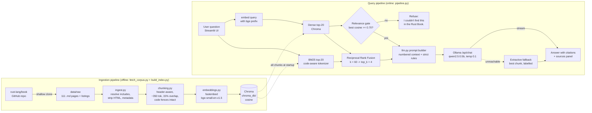

# Architecture

A static PNG of the same flow is at `docs/architecture.png` (drawn with matplotlib by
`scripts/draw_architecture.py`).

## Workflow

**Ingestion (run once)**

1. `scripts/fetch_corpus.py` shallow-clones `rust-lang/book`, copies the 112 `src/*.md` files
   and the 669 listing files they include into `data/raw/`, and records the commit SHA in
   `data/corpus_manifest.json`.
2. `rag/ingest.py` cleans each page: inlines `{{#include}}` / `{{#rustdoc_include}}` directives
   (anchored regions or line ranges only), removes HTML comments, images and `<Listing>` /
   `` wrappers (keeping file names and captions as text), and derives metadata
   (`file`, `chapter_number`, `chapter_title`, `url`). `SUMMARY.md` provides the titles.
3. `rag/chunking.py` splits each page at headings (ignoring `#` lines inside code), then packs
   paragraphs and whole code blocks into chunks of about 350 estimated tokens with about 15%
   overlap, and prepends the heading path (e.g. `Understanding Ownership > References and Borrowing`).
4. `rag/embeddings.py` embeds every chunk with `BAAI/bge-small-en-v1.5` (fastembed, ONNX, 384-d).
5. `rag/store.py` writes ids, texts, metadata and embeddings to a persistent Chroma collection
   using cosine distance.

**Query (per question)**

1. The question is embedded with the bge query prefix and searched in Chroma (dense top-20).
2. The same question is tokenised with a code-aware tokenizer (keeps `Vec<T>`, `&mut`,
   `std::rc`) and scored with BM25 over all chunks (BM25 top-20).
3. Hybrid mode fuses both rankings with Reciprocal Rank Fusion, `score = sum 1/(60 + rank)`,
   and keeps the top 4. (Dense-only and BM25-only modes are also available.)
4. **Relevance gate:** if the best dense cosine similarity is below 0.70, the pipeline returns
   the refusal message without calling the LLM.
5. Otherwise the 4 chunks are numbered `[1]..[4]` and placed in a prompt whose system message
   requires answering only from the context, citing `[n]`, copying code exactly, and replying
   with the exact refusal sentence when the context is insufficient.
6. Ollama (`qwen2.5:0.5b`, temperature 0.1, `num_ctx` 4096, max 400 output tokens) generates
   the answer, streamed to the Streamlit UI. If Ollama cannot be reached, a clearly labelled
   extractive fallback (the best chunk) is shown instead.
7. The UI shows the answer, the latency breakdown, and a sources panel with chapter, heading
   path, scores, a link to the online book page and the full chunk text.
